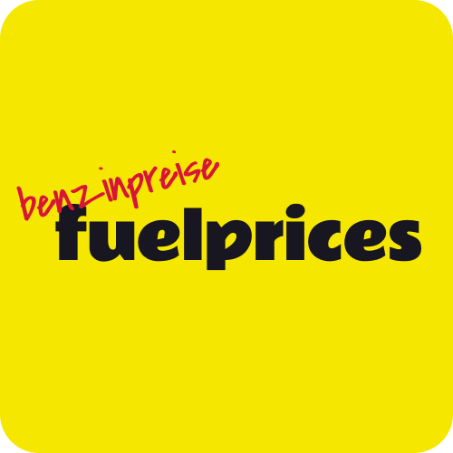
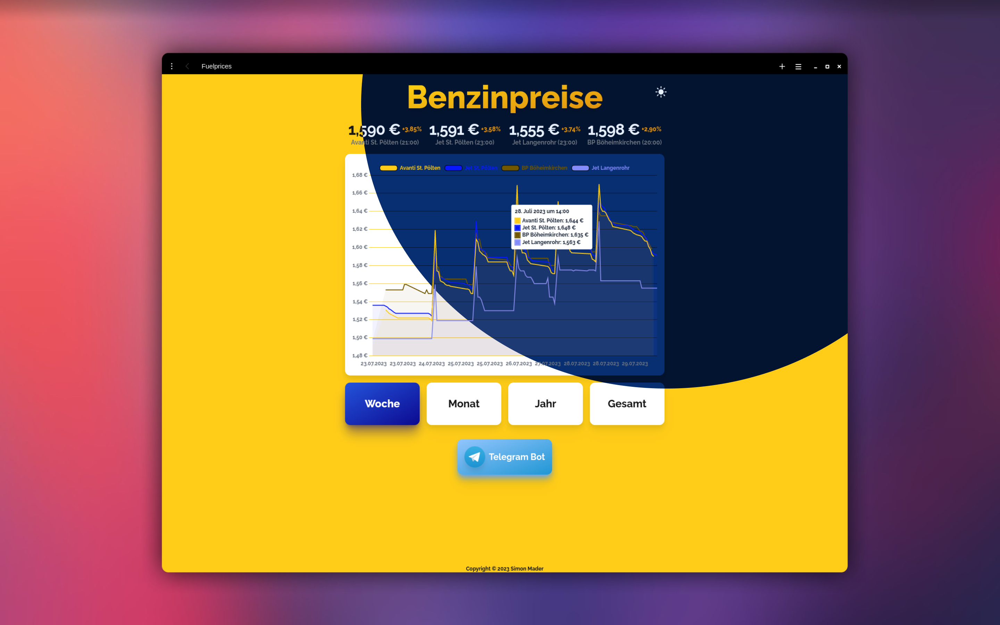

<p align="center">
  <br/>
</p>

<p align="center">
  <a href="https://fuelprices.simonmader.at/">
    
  </a>
  <a href="https://simonmader.at/">
    
  </a>
  <a href="mailto:mail@simonmader.at">  
    
  </a>
  <a href="https://www.linkedin.com/in/simonmader/">  
    
  </a>
  <a href="https://github.com/simonmader17">  
    
  </a>
</p>

## Description

My Fuelprices application consists of a Python [collector](https://github.com/simonmader17/fuelprices-collector) that fetches the current fuel prices of four gas stations around St. Pölten from the official E-Control API every 30 minutes and stores them in a PostgreSQL database.

The [backend](https://github.com/simonmader17/fuelprices-api) is a Java Spring RESTful web service and the frontend I implemented with Svelte.

Additionally, a small [notifier](https://github.com/simonmader17/fuelprices-bot) sends push notifications via [ntfy](https://ntfy.sh) when a station reaches a new weekly/monthly low or high.



## Docker

### `docker-compose.yml`

```yaml
name: fuelprices-svelte
services:
  fuelprices-svelte:
    image: simonmader17/fuelprices-svelte:latest
    container_name: fuelprices-svelte
    restart: always
    environment:
      PUBLIC_NTFY_URL: https://ntfy.example.com
      PUBLIC_NTFY_TOPIC: fuelprices
    ports:
      - 30012:30012
```

| Variable | Description |
|---|---|
| `PUBLIC_NTFY_URL` | Public URL of the ntfy server |
| `PUBLIC_NTFY_TOPIC` | ntfy topic with the price alerts |

Both are read at runtime. If both are set, the page shows a "Preisalarme abonnieren" button that opens the topic in the ntfy web app, where visitors can subscribe in the browser or in the ntfy app. If either is missing, the button is hidden.

### Fuelprices Application Stack

This is my complete Fuelprices application stack, consisting of [Collector](https://github.com/simonmader17/fuelprices-collector) + [API](https://github.com/simonmader17/fuelprices-api) + [Web UI](https://github.com/simonmader17/fuelprices-svelte) + [ntfy Notifier](https://github.com/simonmader17/fuelprices-bot) + a bundled Postgres and a self-hosted [ntfy](https://ntfy.sh) server. The same file is `compose.yaml` in [fuelprices-dev](https://github.com/simonmader17/fuelprices-dev).

`compose.yaml`:

```yaml
name: fuelprices
services:
  db:
    image: postgres:15
    container_name: fuelprices-postgres
    restart: always
    environment:
      POSTGRES_DB: fuelprices
      POSTGRES_USER: ${DATABASE_USERNAME}
      POSTGRES_PASSWORD: ${DATABASE_PASSWORD}
      PGDATA: /var/lib/postgresql/data
    volumes:
      - fuelprices-postgres-data:/var/lib/postgresql/data

  fuelprices-collector:
    image: simonmader17/fuelprices-collector:latest
    container_name: fuelprices-collector
    restart: always
    environment:
      TZ: Europe/Vienna
      DATABASE_URL: db:5432
      DATABASE_USERNAME: ${DATABASE_USERNAME}
      DATABASE_PASSWORD: ${DATABASE_PASSWORD}
    depends_on:
      - db

  # container_name must stay "fuelprices-api": the web UI and notifier call http://fuelprices-api:30011
  fuelprices-api:
    image: simonmader17/fuelprices-api:latest
    container_name: fuelprices-api
    restart: always
    environment:
      DATABASE_URL: db:5432
      DATABASE_USERNAME: ${DATABASE_USERNAME}
      DATABASE_PASSWORD: ${DATABASE_PASSWORD}
    ports:
      - 30011:30011
    depends_on:
      - db

  fuelprices-svelte:
    image: simonmader17/fuelprices-svelte:latest
    container_name: fuelprices-svelte
    restart: always
    environment:
      # Used by the "Preisalarme abonnieren" button; it is hidden if either is empty
      PUBLIC_NTFY_URL: ${NTFY_PUBLIC_URL}
      PUBLIC_NTFY_TOPIC: ${NTFY_TOPIC}
    ports:
      - 30012:30012
    depends_on:
      - fuelprices-api

  fuelprices-bot:
    image: simonmader17/fuelprices-bot:latest
    container_name: fuelprices-bot
    restart: always
    environment:
      NTFY_URL: http://ntfy
      NTFY_TOPIC: ${NTFY_TOPIC}
      NTFY_TOKEN: ${NTFY_TOKEN}
    depends_on:
      - fuelprices-api
      - ntfy

  ntfy:
    image: binwiederhier/ntfy:v2.11.0
    container_name: fuelprices-ntfy
    restart: always
    command: serve
    environment:
      TZ: Europe/Vienna
      NTFY_BASE_URL: ${NTFY_PUBLIC_URL}
      NTFY_CACHE_FILE: /var/lib/ntfy/cache.db
      NTFY_AUTH_FILE: /var/lib/ntfy/auth.db
      # Anyone may subscribe, only users/tokens with write access may publish
      NTFY_AUTH_DEFAULT_ACCESS: read-only
      NTFY_BEHIND_PROXY: "true"
    volumes:
      - fuelprices-ntfy-data:/var/lib/ntfy
    ports:
      - 30013:80

volumes:
  fuelprices-postgres-data:
  fuelprices-ntfy-data:
```

`.env` next to it:

```sh
# Postgres credentials, shared by db, collector and API
DATABASE_USERNAME=fuelprices
DATABASE_PASSWORD=change-me

# Public URL of the ntfy server (what browsers and phones use, e.g. behind a reverse proxy to port 30013)
NTFY_PUBLIC_URL=https://ntfy.example.com
# Topic the notifier publishes to and the web UI's subscribe button links to
NTFY_TOPIC=fuelprices
# Access token with write access to NTFY_TOPIC; create it after the first start (see fuelprices-bot/README.md)
NTFY_TOKEN=
```

After the first start, create the notifier's ntfy token as described in the [fuelprices-bot README](https://github.com/simonmader17/fuelprices-bot#ntfy-token-setup).
